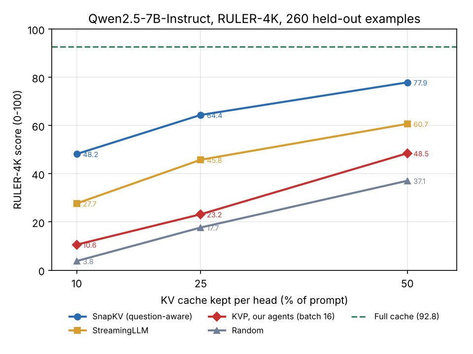

# KVP replication + learned KV-cache allocation (EE599 RL & LLMs)

This repo has our replication of Apple's **KV Policy (KVP)**, from "learned KV-cache eviction with per-head RL agents" ([paper, arXiv 2602.10238](https://arxiv.org/abs/2602.10238), [code](https://github.com/apple/ml-learning-to-evict)). We ran it on **Qwen2.5-7B-Instruct** with **RULER-4K**, using a single GPU on USC CARC.

It is the starting point for our own project. In that project, an RL policy decides **how much KV-cache memory each attention head gets and at what precision**, for each input.

Apple's code is **not** copied here. This repo holds only what we added on top of it: scripts, Slurm jobs, a one-line patch, results and notes.

---

## TL;DR

| | |
|---|---|
| Pipeline reproduced on 1 GPU | ✅ Traces → 112 per-head RL agents → RULER eval, end to end |
| Full-cache RULER-4K score | **92.8** (260 held-out examples) |
| Our KVP agents vs Random | ✅ Better at every budget |
| Our KVP agents vs StreamingLLM | ❌ Worse at every budget (Apple reports KVP > StreamingLLM) |
| Why | Agents are **under-trained**. We trained at **batch 16**, Apple at **batch 128** |
| Proof | Retraining 2 heads at batch 128: reward **−26.75 → −6.77** and **−8.81 → −4.06** (−1 = perfect) |
| Decision | We do not retrain all 112 agents at batch 128 (~756 GPU-hours). The allocation project uses SnapKV / StreamingLLM as the per-head token ranker instead |



---

## 1. Background in one paragraph

During generation an LLM stores a **key** and a **value** for every past token, in every layer and every KV head (Qwen2.5-7B: 28 layers × 4 KV heads = **112 KV heads**, using GQA with 7 query heads per KV head). This is the KV cache, and it grows with context length. **Eviction** methods keep only some tokens per head.

- **StreamingLLM:** keeps the first 4 tokens ("attention sinks") plus the most recent tokens.
- **SnapKV:** keeps the tokens that the last 64 prompt tokens (which include the question) attend to most.
- **KVP (Apple):** trains one small RL agent per KV head. The agent ranks tokens using only their key, value and position, so it never sees the question ("query-agnostic"). Its reward is how much *future* attention lands on the tokens it keeps. Apple trained with RLOO on offline Q/K/V traces.

## 2. Repo layout

```
scripts/
  eval_ruler.py             RULER-4K eval: full / streaming / snapkv / kvp / random (ours; Apple's repo has no eval script)
  summarize_ruler.py        Average + per-task tables from eval outputs
  make_composites_local.py  Builds the agent config without S3 (Apple's registry tools only work with an S3 bucket)
  diag_rewards.py           Diagnostic: agents vs StreamingLLM vs random on Apple's training reward
  diag_rewards2.py          Diagnostic: adds SnapKV and the oracle ceiling; also compares two agent sets
slurm/
  env.sh                    Shared environment (edit SCRATCH / REPO paths)
  preprocess_array.sh       Q/K/V trace extraction for 13 RULER chunks
  train_layer_array.sh      Train 4 agents of one layer per job (batch 16)
  train_b128.sh             Batch-size test: 2 heads at batch 128
  eval_array.sh             RULER eval, one method per array task
  diag.sh                   Runs the diagnostics
patches/
  flex_attention_kernel_options.patch   Needed on L40S / A40 GPUs (see §4)
results/
  ruler4k_summary.csv, ruler4k_per_task.csv, diag_rewards_oracle.csv, batch_size_test.csv, ruler4k_accuracy.png
docs/
  run_log.md                Every Slurm job we ran, with outcome
  related_work.md           Instructor feedback + how our project differs from RLKV / RateQuant / RDKV
.env.example                Apple repo's .env as we set it
```

## 3. How to reproduce (CARC)

All commands run from the **Apple repo root** (`~/ml-learning-to-evict`). Big files live in scratch and are symlinked into the repo.

```bash
# 0. Get Apple's code + this repo
git clone https://github.com/apple/ml-learning-to-evict.git ~/ml-learning-to-evict
git clone <this repo> ~/kvp-team
cp ~/kvp-team/scripts/*.py ~/ml-learning-to-evict/scripts/
cp -r ~/kvp-team/slurm ~/ml-learning-to-evict/slurm
cp ~/kvp-team/.env.example ~/ml-learning-to-evict/.env          # then edit paths
cd ~/ml-learning-to-evict && git apply ~/kvp-team/patches/flex_attention_kernel_options.patch

# 1. Big-file folders in scratch, linked into the repo
mkdir -p /scratch2/$USER/kvp/{models,data,agents,hf_cache,uv_cache}
ln -s /scratch2/$USER/kvp/models models; ln -s /scratch2/$USER/kvp/data data; ln -s /scratch2/$USER/kvp/agents agents

# 2. Python env (run on a compute node; uv crashes on the login node's thread limit)
#    kagglesdk 0.1.24 is yanked -> pin newer versions, otherwise `tune` fails to import
uv add "kagglesdk>=0.1.37; python_version >= '3.11'" "kagglehub>=1.0.2; python_version >= '3.11'"
uv run tune download Qwen/Qwen2.5-7B-Instruct --output-dir models/Qwen2.5-7B-Instruct

# 3. Traces (13 chunks of 100 = one per RULER task, 845 samples, ~760 GB)
sbatch --array=0-12 slurm/preprocess_array.sh
#    then remove split entries whose sample folder doesn't exist:
cd data/gqa_safetensors/simonjegou_ruler/Qwen2.5-7B-Instruct/temperature_0.00
cp train.txt train_full.txt; cp val.txt val_full.txt
for f in train val; do while read s; do [ -d "$s" ] && echo "$s"; done < ${f}_full.txt > ${f}.txt; done   # 801 train / 44 val
cd -

# 4. Train 112 agents (batch 16, 4,000 steps, ~1-1.4 h per agent)
sbatch --array=0-27%8 slurm/train_layer_array.sh

# 5. Agent config + eval
uv run python scripts/make_composites_local.py ruler845_v1
sbatch --array=0-4 slurm/eval_array.sh
uv run python scripts/summarize_ruler.py results
```

## 4. What we changed vs Apple's setup (and why)

| Change | Why |
|---|---|
| **Batch 16** instead of 128 (`loader.train.batch_size=16`), `compile_agent=False` | Apple used 8 GPUs; batch 32 ran out of memory on one GPU (OOM at step 1029). **This turned out to be the cause of the weak agents** (see §6) |
| 845 training samples (13 of 100 RULER-4K chunks, one per task) | Storage and time. Each sample is ~0.9 GB of Q/K/V traces |
| `PYTORCH_ALLOC_CONF=expandable_segments:True` | Reduces memory fragmentation OOMs |
| `make_composites_local.py` | Apple's `agent_registry.py` / `assignment_generator.py` require an S3 bucket. Ours points each agent at its local `best_ckpt.pth` |
| `eval_ruler.py` | Apple's public repo has no evaluation script, only a demo notebook. Ours reuses their `KVCompressor` + `generate_with_compression` |
| **flex-attention patch** (`kernel_options` BLOCK 64, 1 stage) | The default kernel needs 112 KB of shared memory. L40S/A40 have ~99 KB, which gives "No valid triton configs … out of resource". Only affects speed, not results |
| GPUs `--constraint=a40\|a100\|l40s` | The default partition can give P100s (sm_60, unsupported, too small) |

Messages like "storage failed / Upload … failed" with an `s3_utils.py` traceback at the end of training logs are **harmless**. That's the S3 upload, and agents are saved locally.

## 5. Results: RULER-4K

**Eval protocol** (`scripts/eval_ruler.py`):
- **Data:** 20 held-out examples per task × 13 tasks = 260. Every sample used for training is excluded.
- **Compression:** the prompt (context + question) is prefilled, then the cache is compressed **once**, as in Apple's demo. Each KV head keeps `ratio × prompt_len` tokens (uniform budget).
- **KVP setting:** the agents force-keep 4 sinks + 16 recent tokens, as in Apple's notebook.
- **Scoring:** RULER string match. For `qa_*`, any reference answer counts. For other tasks, the score is the fraction of reference answers found. Range 0–100.

| Kept per head | Random | **KVP (ours, batch 16)** | StreamingLLM | SnapKV |
|---|---|---|---|---|
| 10% | 3.8 | **10.6** | 27.7 | 48.2 |
| 25% | 17.7 | **23.2** | 45.8 | 64.4 |
| 50% | 37.1 | **48.5** | 60.7 | 77.9 |

Full cache: **92.8**. Per-task numbers are in `results/ruler4k_per_task.csv`.

**Reading it:**
- **SnapKV winning is expected.** Apple's paper says RULER "heavily favors" question-aware methods like SnapKV and TOVA. KVP's claim is to beat the *question-blind* methods (StreamingLLM, KeyDiff, K-Norm, Random).
- **KVP losing to StreamingLLM means we did not replicate that claim.** §6 explains why.

## 6. Why our KVP is weak: diagnostics

We scored rankings directly on **Apple's own training reward**, using held-out validation traces. The reward is the negative normalized future-attention AUC: **−1 = perfect, lower = worse**. The *oracle* ranks tokens by the attention they actually receive later, so it scores exactly −1.

**Diagnostic 1** (32 agents: layers 0,4,…,27 × 4 heads; 12 traces each):

| | Random | StreamingLLM | KVP | KVP + 4 sinks / 16 recent |
|---|---|---|---|---|
| Mean reward | −34.67 | −10.27 | −9.45 | **−7.79** |

**Diagnostic 2** (16 agents: layers 0, 8, 16, 27; `results/diag_rewards_oracle.csv`):

| | Oracle | SnapKV | KVP + sinks/recent | StreamingLLM |
|---|---|---|---|---|
| Mean reward | −1.00 | −2.68 | **−7.86** | −8.09 |

Our agents are only **slightly better than "keep the most recent tokens"** and far from the ceiling. In layer 0 they are even worse than StreamingLLM for 3 of the 4 heads.

**Batch-size test** (`slurm/train_b128.sh`; `results/batch_size_test.csv`): we retrained the two worst heads at Apple's batch 128. It fits on one 48 GB GPU with `trainer.gumbel_sampling_chunk_size=4`.

| Head | Batch 16 | **Batch 128** | Time at batch 128 |
|---|---|---|---|
| Layer 16, head 1 | −26.75 | **−6.77** | 6h43 |
| Layer 8, head 3 | −8.81 | **−4.06** | 6h44 |

**Conclusion:** KVP's quality depends heavily on large-batch RL. Single-GPU training at batch 16 does not reproduce it, and batch 128 largely fixes it. Retraining all 112 agents would cost **~756 GPU-hours**, so we are not doing it.

## 7. Next: our project

**Goal:** an RL policy that, **for each input**, splits a fixed KV-memory budget across the **112 KV heads**, choosing a token budget and a precision (full / 4-bit / 2-bit) per head. Reward: output KL vs the full cache over several decoding steps. The policy doesn't depend on which method ranks tokens inside a head, so we use **SnapKV / StreamingLLM** as within-head rankers (and our batch-16 KVP as a weak query-agnostic one).

Planned steps:
1. **Head profiling:** how much the output KL changes when one head's cache shrinks.
2. **Fixed allocation baseline** from the profile vs uniform allocation.
3. **Precision modes,** counting quantization scales/zero-points and index overhead in the memory budget.
4. **RL policy** (per input) + the ablations the instructor asked for.

How this differs from RLKV, RateQuant and RDKV is in [`docs/related_work.md`](docs/related_work.md).

## 8. Where the raw outputs live

Raw outputs are on CARC (not in git; too large or regenerable):
- Per-example eval outputs: `~/ml-learning-to-evict/results/ruler_<method>.jsonl`, with the prediction, answer and score for each example.
- Trained agents: `/scratch2/sanjayba/kvp/agents/grouped/ruler845_v1/` (112, batch 16) and `.../ruler845_b128/` (2, batch 128).
- Traces: `/scratch2/sanjayba/kvp/data/gqa_safetensors/...` (~760 GB).
