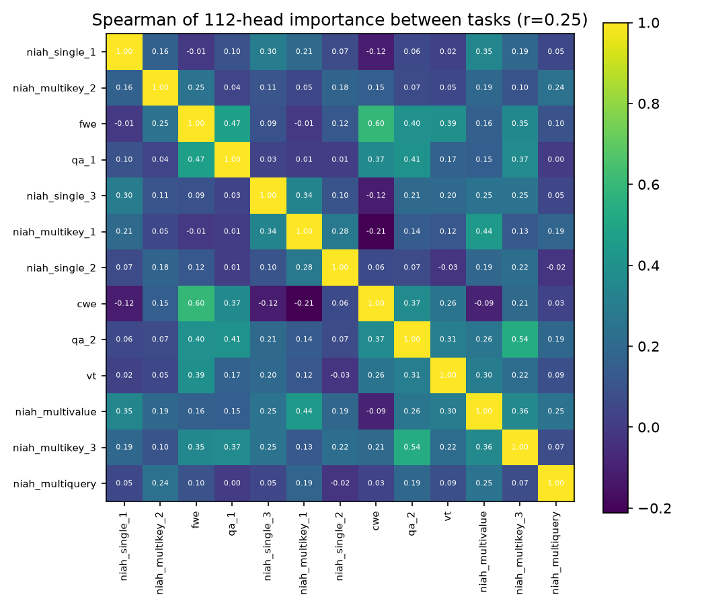

# Per-KV-head sensitivity profile (kvp)

65 prompts, 13 tasks, keep ratios [0.02, 0.05, 0.1, 0.25, 0.5]. KL(p_full || p_compressed) in nats, mean over 32 teacher-forced continuation positions.

## Top-10 most sensitive heads (r=0.25)
| rank | layer | kv_head | mean KL | top1 agree |
|---|---|---|---|---|
| 1 | 22 | 0 | 4.984e-02 | 0.981 |
| 2 | 4 | 1 | 1.877e-02 | 0.993 |
| 3 | 26 | 0 | 1.345e-02 | 0.994 |
| 4 | 23 | 1 | 6.874e-03 | 0.996 |
| 5 | 27 | 0 | 6.572e-03 | 0.995 |
| 6 | 24 | 3 | 6.200e-03 | 0.994 |
| 7 | 14 | 1 | 5.809e-03 | 0.996 |
| 8 | 8 | 3 | 5.087e-03 | 0.998 |
| 9 | 27 | 3 | 5.004e-03 | 0.997 |
| 10 | 20 | 3 | 4.722e-03 | 0.994 |

## Bottom-10 least sensitive heads (r=0.25)
| rank | layer | kv_head | mean KL | top1 agree |
|---|---|---|---|---|
| 1 | 25 | 0 | 1.907e-05 | 1.000 |
| 2 | 27 | 1 | 3.346e-05 | 1.000 |
| 3 | 23 | 3 | 3.419e-05 | 1.000 |
| 4 | 19 | 1 | 4.041e-05 | 1.000 |
| 5 | 24 | 0 | 4.195e-05 | 0.998 |
| 6 | 6 | 3 | 4.484e-05 | 1.000 |
| 7 | 3 | 3 | 4.563e-05 | 1.000 |
| 8 | 18 | 0 | 4.631e-05 | 0.998 |
| 9 | 7 | 3 | 5.170e-05 | 0.998 |
| 10 | 7 | 2 | 5.333e-05 | 0.998 |

## Input dependence

Average pairwise Spearman between tasks' 112-head importance vectors: **0.169** (min -0.212, max 0.596).

Prompt-level noise floor: same-task prompt pairs average 0.203, cross-task prompt pairs average 0.076. If cross-task is clearly below same-task, head importance depends on the input type.

|                 |   niah_single_1 |   niah_multikey_2 |   fwe |   qa_1 |   niah_single_3 |   niah_multikey_1 |   niah_single_2 |   cwe |   qa_2 |    vt |   niah_multivalue |   niah_multikey_3 |   niah_multiquery |
|:----------------|----------------:|------------------:|------:|-------:|----------------:|------------------:|----------------:|------:|-------:|------:|------------------:|------------------:|------------------:|
| niah_single_1   |            1    |              0.16 | -0.01 |   0.1  |            0.3  |              0.21 |            0.07 | -0.12 |   0.06 |  0.02 |              0.35 |              0.19 |              0.05 |
| niah_multikey_2 |            0.16 |              1    |  0.25 |   0.04 |            0.11 |              0.05 |            0.18 |  0.15 |   0.07 |  0.05 |              0.19 |              0.1  |              0.24 |
| fwe             |           -0.01 |              0.25 |  1    |   0.47 |            0.09 |             -0.01 |            0.12 |  0.6  |   0.4  |  0.39 |              0.16 |              0.35 |              0.1  |
| qa_1            |            0.1  |              0.04 |  0.47 |   1    |            0.03 |              0.01 |            0.01 |  0.37 |   0.41 |  0.17 |              0.15 |              0.37 |              0    |
| niah_single_3   |            0.3  |              0.11 |  0.09 |   0.03 |            1    |              0.34 |            0.1  | -0.12 |   0.21 |  0.2  |              0.25 |              0.25 |              0.05 |
| niah_multikey_1 |            0.21 |              0.05 | -0.01 |   0.01 |            0.34 |              1    |            0.28 | -0.21 |   0.14 |  0.12 |              0.44 |              0.13 |              0.19 |
| niah_single_2   |            0.07 |              0.18 |  0.12 |   0.01 |            0.1  |              0.28 |            1    |  0.06 |   0.07 | -0.03 |              0.19 |              0.22 |             -0.02 |
| cwe             |           -0.12 |              0.15 |  0.6  |   0.37 |           -0.12 |             -0.21 |            0.06 |  1    |   0.37 |  0.26 |             -0.09 |              0.21 |              0.03 |
| qa_2            |            0.06 |              0.07 |  0.4  |   0.41 |            0.21 |              0.14 |            0.07 |  0.37 |   1    |  0.31 |              0.26 |              0.54 |              0.19 |
| vt              |            0.02 |              0.05 |  0.39 |   0.17 |            0.2  |              0.12 |           -0.03 |  0.26 |   0.31 |  1    |              0.3  |              0.22 |              0.09 |
| niah_multivalue |            0.35 |              0.19 |  0.16 |   0.15 |            0.25 |              0.44 |            0.19 | -0.09 |   0.26 |  0.3  |              1    |              0.36 |              0.25 |
| niah_multikey_3 |            0.19 |              0.1  |  0.35 |   0.37 |            0.25 |              0.13 |            0.22 |  0.21 |   0.54 |  0.22 |              0.36 |              1    |              0.07 |
| niah_multiquery |            0.05 |              0.24 |  0.1  |   0    |            0.05 |              0.19 |           -0.02 |  0.03 |   0.19 |  0.09 |              0.25 |              0.07 |              1    |

## Stability across keep ratios (Spearman, r=0.1 vs r=0.5)

- mean over prompts: 0.817
- per prompt (mean): 0.244

## Run

- GPU: NVIDIA A40
- Runtime: 810.4 s (last invocation)
- Model: /scratch1/chenpaul/kvp/models/Qwen2.5-7B-Instruct, torch 2.10.0+cu128, transformers 4.57.1
