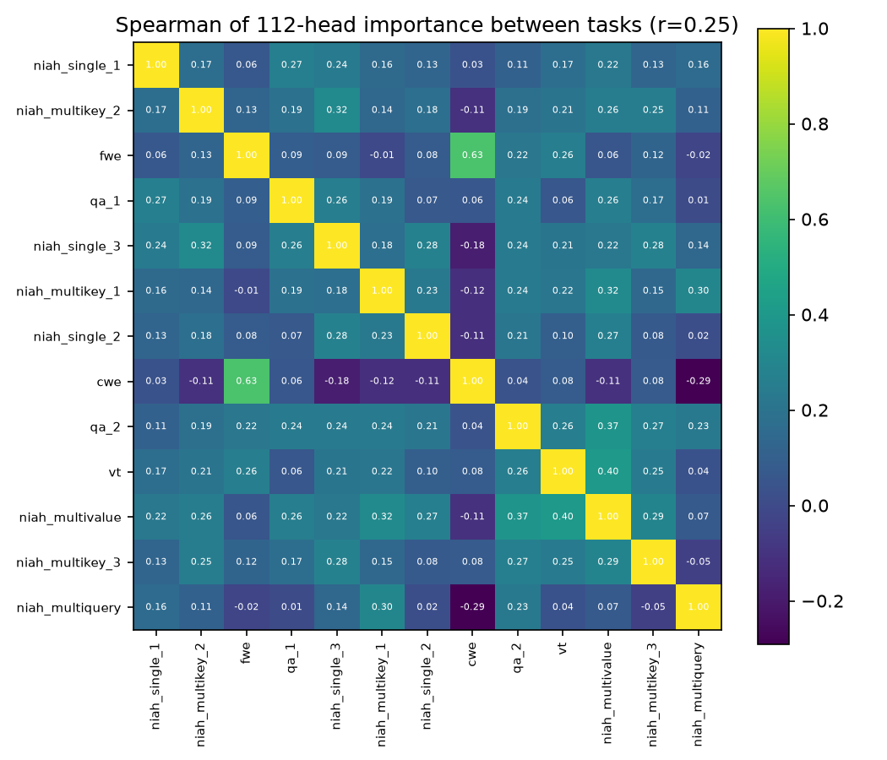

# Per-KV-head sensitivity profile (snapkv)

65 prompts, 13 tasks, keep ratios [0.1, 0.25, 0.5]. KL(p_full || p_compressed) in nats, mean over 32 teacher-forced continuation positions.

## Top-10 most sensitive heads (r=0.25)
| rank | layer | kv_head | mean KL | top1 agree |
|---|---|---|---|---|
| 1 | 22 | 0 | 6.004e-02 | 0.983 |
| 2 | 4 | 1 | 2.822e-02 | 0.986 |
| 3 | 8 | 3 | 5.907e-03 | 0.996 |
| 4 | 19 | 2 | 3.548e-03 | 0.993 |
| 5 | 20 | 3 | 2.315e-03 | 0.995 |
| 6 | 23 | 1 | 2.268e-03 | 0.996 |
| 7 | 17 | 2 | 1.704e-03 | 0.996 |
| 8 | 27 | 3 | 1.295e-03 | 0.999 |
| 9 | 14 | 0 | 1.224e-03 | 0.995 |
| 10 | 27 | 2 | 1.157e-03 | 0.998 |

## Bottom-10 least sensitive heads (r=0.25)
| rank | layer | kv_head | mean KL | top1 agree |
|---|---|---|---|---|
| 1 | 27 | 1 | 1.130e-05 | 1.000 |
| 2 | 24 | 0 | 3.038e-05 | 1.000 |
| 3 | 22 | 2 | 3.348e-05 | 1.000 |
| 4 | 23 | 3 | 3.362e-05 | 1.000 |
| 5 | 24 | 1 | 3.368e-05 | 1.000 |
| 6 | 25 | 0 | 3.419e-05 | 1.000 |
| 7 | 19 | 1 | 3.534e-05 | 0.999 |
| 8 | 18 | 0 | 3.707e-05 | 1.000 |
| 9 | 17 | 0 | 3.914e-05 | 1.000 |
| 10 | 24 | 2 | 4.106e-05 | 1.000 |

## Input dependence

Average pairwise Spearman between tasks' 112-head importance vectors: **0.151** (min -0.291, max 0.634).

Prompt-level noise floor: same-task prompt pairs average 0.185, cross-task prompt pairs average 0.072. If cross-task is clearly below same-task, head importance depends on the input type.

|                 |   niah_single_1 |   niah_multikey_2 |   fwe |   qa_1 |   niah_single_3 |   niah_multikey_1 |   niah_single_2 |   cwe |   qa_2 |   vt |   niah_multivalue |   niah_multikey_3 |   niah_multiquery |
|:----------------|----------------:|------------------:|------:|-------:|----------------:|------------------:|----------------:|------:|-------:|-----:|------------------:|------------------:|------------------:|
| niah_single_1   |            1    |              0.17 |  0.06 |   0.27 |            0.24 |              0.16 |            0.13 |  0.03 |   0.11 | 0.17 |              0.22 |              0.13 |              0.16 |
| niah_multikey_2 |            0.17 |              1    |  0.13 |   0.19 |            0.32 |              0.14 |            0.18 | -0.11 |   0.19 | 0.21 |              0.26 |              0.25 |              0.11 |
| fwe             |            0.06 |              0.13 |  1    |   0.09 |            0.09 |             -0.01 |            0.08 |  0.63 |   0.22 | 0.26 |              0.06 |              0.12 |             -0.02 |
| qa_1            |            0.27 |              0.19 |  0.09 |   1    |            0.26 |              0.19 |            0.07 |  0.06 |   0.24 | 0.06 |              0.26 |              0.17 |              0.01 |
| niah_single_3   |            0.24 |              0.32 |  0.09 |   0.26 |            1    |              0.18 |            0.28 | -0.18 |   0.24 | 0.21 |              0.22 |              0.28 |              0.14 |
| niah_multikey_1 |            0.16 |              0.14 | -0.01 |   0.19 |            0.18 |              1    |            0.23 | -0.12 |   0.24 | 0.22 |              0.32 |              0.15 |              0.3  |
| niah_single_2   |            0.13 |              0.18 |  0.08 |   0.07 |            0.28 |              0.23 |            1    | -0.11 |   0.21 | 0.1  |              0.27 |              0.08 |              0.02 |
| cwe             |            0.03 |             -0.11 |  0.63 |   0.06 |           -0.18 |             -0.12 |           -0.11 |  1    |   0.04 | 0.08 |             -0.11 |              0.08 |             -0.29 |
| qa_2            |            0.11 |              0.19 |  0.22 |   0.24 |            0.24 |              0.24 |            0.21 |  0.04 |   1    | 0.26 |              0.37 |              0.27 |              0.23 |
| vt              |            0.17 |              0.21 |  0.26 |   0.06 |            0.21 |              0.22 |            0.1  |  0.08 |   0.26 | 1    |              0.4  |              0.25 |              0.04 |
| niah_multivalue |            0.22 |              0.26 |  0.06 |   0.26 |            0.22 |              0.32 |            0.27 | -0.11 |   0.37 | 0.4  |              1    |              0.29 |              0.07 |
| niah_multikey_3 |            0.13 |              0.25 |  0.12 |   0.17 |            0.28 |              0.15 |            0.08 |  0.08 |   0.27 | 0.25 |              0.29 |              1    |             -0.05 |
| niah_multiquery |            0.16 |              0.11 | -0.02 |   0.01 |            0.14 |              0.3  |            0.02 | -0.29 |   0.23 | 0.04 |              0.07 |             -0.05 |              1    |

## Stability across keep ratios (Spearman, r=0.1 vs r=0.5)

- mean over prompts: 0.635
- per prompt (mean): 0.222

## Run

- GPU: NVIDIA A100 80GB PCIe
- Runtime: 416.6 s (last invocation)
- Model: Qwen/Qwen2.5-7B-Instruct, torch 2.15.0+cu132, transformers 4.57.1
