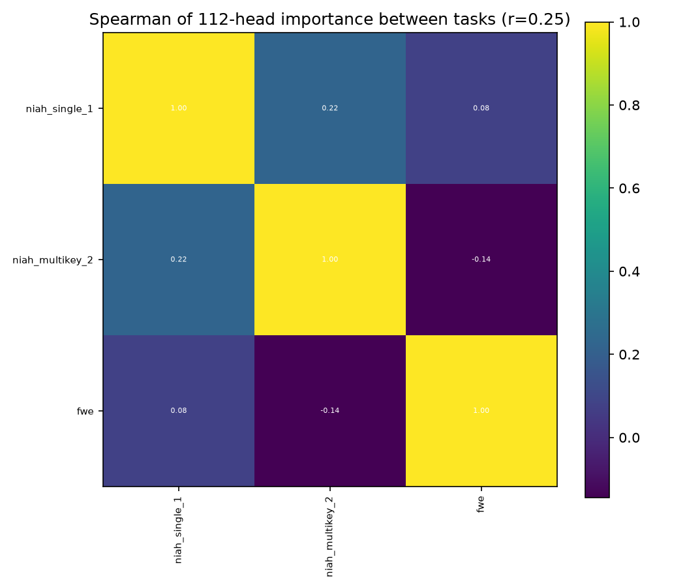

# Per-KV-head sensitivity profile (snapkv)

9 prompts, 3 tasks, keep ratios [0.02, 0.05, 0.1, 0.25, 0.5]. KL(p_full || p_compressed) in nats, mean over 32 teacher-forced continuation positions.

## Top-10 most sensitive heads (r=0.25)
| rank | layer | kv_head | mean KL | top1 agree |
|---|---|---|---|---|
| 1 | 22 | 0 | 1.425e-01 | 0.975 |
| 2 | 4 | 1 | 4.934e-02 | 0.955 |
| 3 | 22 | 3 | 2.855e-03 | 1.000 |
| 4 | 17 | 3 | 1.973e-03 | 1.000 |
| 5 | 19 | 2 | 1.627e-03 | 0.992 |
| 6 | 20 | 3 | 1.384e-03 | 1.000 |
| 7 | 24 | 3 | 1.246e-03 | 0.992 |
| 8 | 17 | 2 | 1.022e-03 | 1.000 |
| 9 | 15 | 2 | 8.388e-04 | 1.000 |
| 10 | 8 | 3 | 5.764e-04 | 0.992 |

## Bottom-10 least sensitive heads (r=0.25)
| rank | layer | kv_head | mean KL | top1 agree |
|---|---|---|---|---|
| 1 | 24 | 0 | 6.178e-06 | 1.000 |
| 2 | 25 | 0 | 7.108e-06 | 1.000 |
| 3 | 19 | 1 | 8.429e-06 | 1.000 |
| 4 | 23 | 0 | 9.730e-06 | 1.000 |
| 5 | 27 | 1 | 1.009e-05 | 1.000 |
| 6 | 16 | 3 | 1.168e-05 | 1.000 |
| 7 | 15 | 1 | 1.226e-05 | 1.000 |
| 8 | 20 | 1 | 1.391e-05 | 1.000 |
| 9 | 3 | 0 | 1.400e-05 | 1.000 |
| 10 | 23 | 2 | 1.408e-05 | 1.000 |

## Input dependence

Average pairwise Spearman between tasks' 112-head importance vectors: **0.052** (min -0.145, max 0.224).

Prompt-level noise floor: same-task prompt pairs average 0.207, cross-task prompt pairs average 0.030. If cross-task is clearly below same-task, head importance depends on the input type.

|                 |   niah_single_1 |   niah_multikey_2 |   fwe |
|:----------------|----------------:|------------------:|------:|
| niah_single_1   |            1    |              0.22 |  0.08 |
| niah_multikey_2 |            0.22 |              1    | -0.14 |
| fwe             |            0.08 |             -0.14 |  1    |

## Stability across keep ratios (Spearman, r=0.1 vs r=0.5)

- mean over prompts: 0.560
- per prompt (mean): 0.211

## Run

- GPU: ?
- Runtime: ? s (last invocation)
- Model: ?, torch ?, transformers ?
